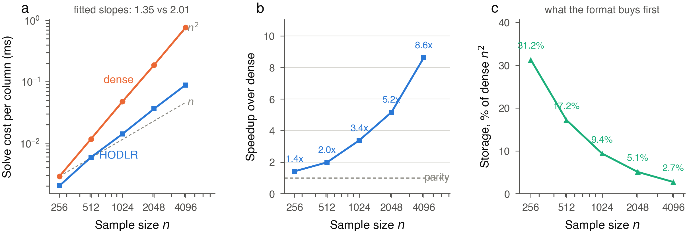
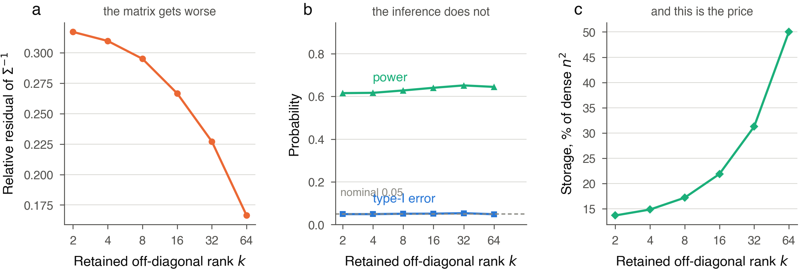
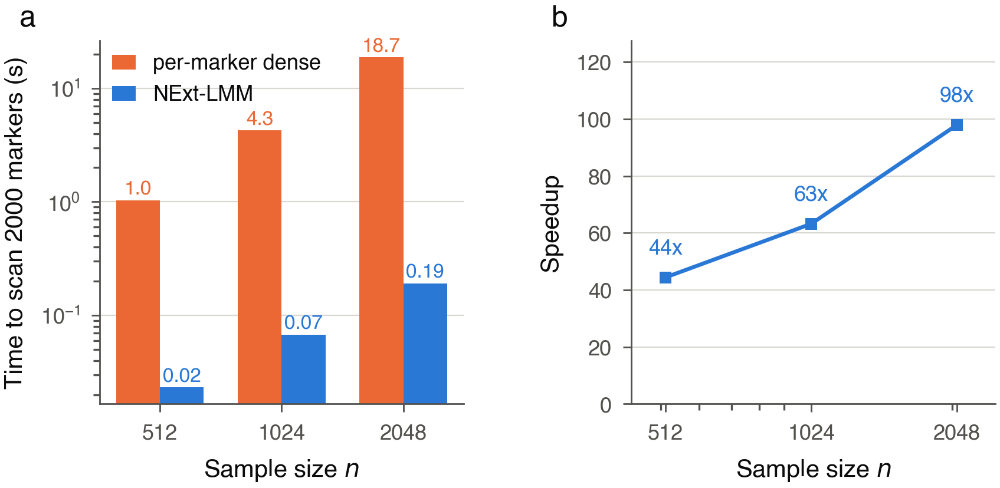

# NExt-LMM

A two-stage linear mixed model for genome-wide association studies,
accelerated by a hierarchical off-diagonal low-rank (HODLR)
representation of the covariance.

Implements

> Zhibin Pu, Shufei Ge, Shijia Wang, "NExt-LMM: a two-stage LMM
> framework with near-exact variance components for genome-wide
> association studies", arXiv:2508.05278v2.

```python
import sys; sys.path.insert(0, "code")
from NExt import NExt

model = NExt(y, max_rank=8, randomized=True).fit(W, K)
p_values = model.association()
evidence = model.evidence(K)      # what the approximation cost
```

## What the method does

A standard LMM re-estimates the variance components for every marker,
which means a fresh `n x n` decomposition per test. NExt-LMM estimates
a single shared variance ratio under the null by PCGC regression, then
factors `Sigma = lambda K + I` **once** and reuses that factorisation
across the whole scan.

The factorisation is hierarchical: the covariance is split in half, the
off-diagonal blocks are replaced by truncated SVDs, and the diagonal
blocks are split again, down to dense terminal blocks. Applying the
inverse then costs `O(k n log n)` instead of `O(n^2)`, with `k` the
retained off-diagonal rank.

### HODLR is lossy, and that is the design

The rank `k` is **chosen, not discovered**. A matrix whose off-diagonal
blocks happen to be low rank compresses for free; one whose blocks are
full rank still compresses, and pays in accuracy instead.

Genetic similarity matrices are the second kind. Measured on simulated
GSMs and on real ADNI genotypes, the off-diagonal blocks retain
essentially full numerical rank — the singular values of a 512 x 512
block fall from 1.00 to 0.91 across the first eight, which together
hold 8% of the spectral energy. So `k` is a dial set against a budget,
and every result carries what the setting cost.

What makes that safe is that the approximate inverse stays **symmetric
and positive definite**. Generalised least squares with any
positive-definite weight is unbiased; a suboptimal weight costs
efficiency, not validity. And since the residual variance is computed
through the same approximate inverse, the reported standard error stays
honest rather than drifting from the realised spread.

## Results

All figures are regenerated by `benchmarks/run_benchmarks.py` followed
by `benchmarks/make_figures.py`; the numbers behind them are in
`benchmarks/results.json`. Measured single-threaded on an Intel
i5-7360U.

### The asymptotic claim, measured



Solve cost per column against sample size, on a log-log axis where a
power law is a straight line. The fitted slopes are **1.35 for HODLR
against 2.01 for dense** — the dense curve lies on its `n^2` guide,
and the HODLR curve sits between `n` and `n^2`, which is what
`O(k n log n)` looks like over this range.

The speedup therefore grows with the problem: 1.4x at n = 256, **8.6x
at n = 4096**. Storage is the other half of the story and arrives
sooner — 31% of a dense inverse at n = 256, 2.7% at n = 4096.

### The rank dial



The trade the method actually offers, at n = 512 over 60 replicates.
The left panel is the matrix error, the middle panel is what that error
does to the inference, and the right panel is the price.

Reading them together is the point: from rank 64 down to rank 2 the
relative residual of the inverse nearly doubles, from 0.166 to 0.317,
while **type-I error stays between 0.049 and 0.053** against a nominal
0.05 and power moves from 0.644 to 0.615. Storage falls from 50% of
dense to 14%.

A spectral error of 0.3 looks alarming and costs about 3% of power.
That is the gap between what the error bound in the paper's
Proposition 1 guarantees — a worst case over all quadratic forms — and
what an association test actually probes, which is a two-dimensional
subspace of them.

### End to end



Scanning 2000 markers, against the per-marker dense approach: 44x at
n = 512, rising to **98x at n = 2048**.

## Installation

```bash
git clone <this repository>
cd NExt-LMM
pip install -r requirements.txt
```

The compiled kernel is optional and worth 1.3-1.6x on the solve:

```bash
pip install cython
cd code && python setup.py build_ext --inplace
```

Without it, `HodlrInverse` uses its Python path and returns the same
answers — a test switches the extension off to check exactly that.

## API

### `NExt(Y, min_block=64, tolerance=1e-6, max_rank=None, randomized=False)`

| | |
|---|---|
| `pcgc(K)` | Shared heritability by PCGC regression, clamped to `[0, 1]`. |
| `factorise(K, h2)` | Build `Sigma = lambda K + I` and factor it. |
| `fit(W, K, h=None)` | Scan. `h=None` estimates it by PCGC. |
| `association()` | Two-sided Wald p-values. A monomorphic marker gives NaN rather than a spurious effect. |
| `evidence(K)` | Retained rank, storage, relative residual, variance components. |

`max_rank` is the accuracy dial. `randomized=True` builds the factors
by random projection, roughly 10x faster for about 2% more residual —
see the note in `code/README.md` on why a flat spectrum makes that
trade favourable rather than unfavourable.

### `HInverse(matrix, min_block=64, tolerance=1e-6, max_rank=None, randomized=False)`

| | |
|---|---|
| `matvec(v)`, `matmat(B)` | Apply the inverse without forming it. |
| `to_dense()` | Materialise it — `O(n^2)` storage, and it discards the format's advantage. For tests and callers that need the entries. |
| `error_bound(matrix)` | Relative residual by random probing, retained rank, storage against dense. |

## Repository

```
code/
  HodlrInverse.py            the HODLR factorisation and solve
  NExt.py                    PCGC, the scan, the Wald test
  _hodlr_fast.pyx            optional compiled inner loop
  setup.py                   builds the extension
  README.md                  implementation notes and defect history
  HodlrInverse_published.py  archived 2024 release, for reference
  NExt_published.py
  test data/                 the small example shipped with the paper
tests/                       52 tests
benchmarks/                  the measurements behind the figures
figures/                     the figures above
```

## Changes from the released version

The originals are archived as `code/*_published.py`. Three defects were
fixed; all three are invisible in a trace plot, which is why they
lasted. `code/README.md` documents each with the measurement that
exposed it.

**The recursion had never run.** `HInverse.__init__` called an
undefined name, so every call with a block above the leaf size raised
`NameError`. Only the dense leaf path had ever executed — the paper's
Algorithm 1 had not been run by the code released with it.

**The Schur complement was inverted densely.** Algorithm 1 line 10
specifies a recursive call; the released code used `np.linalg.inv`,
collapsing the recursion to a single level whatever the matrix size.

**The association statistic divided by the wrong quantity.** The
released code computed `T = beta / np.std(beta)`, dividing each
marker's effect by the spread of effects across markers. Under a pure
null that is calibrated, so it went unnoticed; but real signal enters
its own denominator. With 24 causal markers out of 60 it recovered
17.0% of them against 29.7% for the Wald statistic the paper's
Equations (7) and (8) imply, and the gap widens as the architecture
gets denser.

Two smaller corrections: PCGC now solves Equation (5) as written (no
intercept, clamped to `[0, 1]`), and the covariance is `lambda K + I`
with `lambda = h2/(1-h2)` rather than `h2 K + (1-h2) I` — the two
differ by a constant factor, which GLS ignores for `beta` and does not
ignore for `sigma_e^2`.

## Tests

```bash
pytest -q                  # 52 tests, ~5 s
pytest -m "not slow" -q    # skipping the Monte Carlo checks
```

They assert behaviour against known truths — an exact dense solve, a
null that is true by construction, identities that hold at any rank —
rather than against stored numbers, which would only pin the
implementation to itself.

## Citation

```
Zhibin Pu, Shufei Ge, Shijia Wang, "NExt-LMM: a two-stage LMM framework
with near-exact variance components for genome-wide association
studies", arXiv:2508.05278v2, 2025.
```

## Licence

BSD 2-clause. See [LICENSE](LICENSE).

Copyright (c) 2025. Zhibin Pu, Shijia Wang and Shufei Ge.

## Contact

puzhb2022@shanghaitech.edu.cn, geshf@shanghaitech.edu.cn,
wangshj1@shanghaitech.edu.cn
